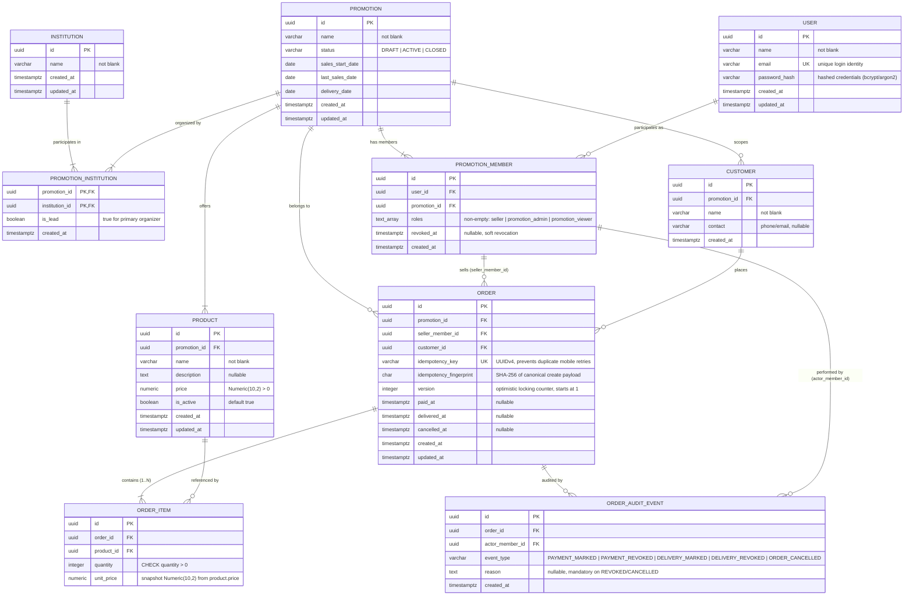

# Entity Relationship Model (ERM) — PromoLedger

This document defines the physical and logical database schema, data dictionary, relational constraints, and domain invariants for the **PromoLedger** platform (PostgreSQL engine).

> **Physical naming convention:** tables are singular `snake_case` versions of the entity names below, except where the entity name is a PostgreSQL reserved word: `USER` → `app_user`, `ORDER` → `customer_order`.
>
> **Timestamps:** `created_at` / `updated_at` have `DEFAULT NOW()` in DDL; `updated_at` is refreshed on every ORM `UPDATE` (`onupdate=now()`), and server-generated values are fetched back via `RETURNING` (`eager_defaults`).

---

## 1. Entity Relationship Diagram (ERD)

---

## 2. Data Dictionary & Table Specifications

### 2.1 `INSTITUTION`

Multi-tenant organizational boundary (schools, churches, student committees, NGOs).

| Column       | Type           | Constraints                                     | Description                  |
| ------------ | -------------- | ----------------------------------------------- | ---------------------------- |
| `id`         | `UUID`         | PK, default `gen_random_uuid()`                 | Unique entity identifier.    |
| `name`       | `VARCHAR(255)` | NOT NULL, CHECK (`char_length(trim(name)) > 0`) | Legal or operational name.   |
| `created_at` | `TIMESTAMPTZ`  | NOT NULL, default `NOW()`                       | Record creation timestamp.   |
| `updated_at` | `TIMESTAMPTZ`  | NOT NULL, default `NOW()`                       | Last modification timestamp. |

---

### 2.2 `PROMOTION`

A specific fundraising campaign with a defined timeline and batch delivery date.

| Column             | Type           | Constraints                                                           | Description                                           |
| ------------------ | -------------- | --------------------------------------------------------------------- | ----------------------------------------------------- |
| `id`               | `UUID`         | PK, default `gen_random_uuid()`                                       | Unique promotion identifier.                          |
| `name`             | `VARCHAR(255)` | NOT NULL, CHECK (`char_length(trim(name)) > 0`)                       | Campaign title (e.g., "Easter Chocolate Drive 2026"). |
| `status`           | `VARCHAR(32)`  | NOT NULL, default `'DRAFT'`, CHECK in `('DRAFT', 'ACTIVE', 'CLOSED')` | Operational state of the campaign.                    |
| `sales_start_date` | `DATE`         | NOT NULL                                                              | Date when sellers can begin collecting orders.        |
| `last_sales_date`  | `DATE`         | NOT NULL, CHECK (`last_sales_date >= sales_start_date`)               | Final cutoff date for order capture.                  |
| `delivery_date`    | `DATE`         | NOT NULL, CHECK (`delivery_date >= last_sales_date`)                  | Scheduled centralized batch fulfillment day.          |
| `created_at`       | `TIMESTAMPTZ`  | NOT NULL, default `NOW()`                                             | Record creation timestamp.                            |
| `updated_at`       | `TIMESTAMPTZ`  | NOT NULL, default `NOW()`                                             | Last modification timestamp.                          |

> **Status transitions:** `DRAFT → ACTIVE`, `ACTIVE → CLOSED`, `CLOSED → ACTIVE` (reopen). Returning to `DRAFT` is not allowed. Setting the current status again is a no-op.

---

### 2.3 `PROMOTION_INSTITUTION`

Associative table supporting campaigns co-organized by multiple partner institutions (N:N).

| Column           | Type          | Constraints                                    | Description                                  |
| ---------------- | ------------- | ---------------------------------------------- | -------------------------------------------- |
| `promotion_id`   | `UUID`        | PK, FK -> `PROMOTION(id)` ON DELETE CASCADE    | Target promotion.                            |
| `institution_id` | `UUID`        | PK, FK -> `INSTITUTION(id)` ON DELETE RESTRICT | Participating organization.                  |
| `is_lead`        | `BOOLEAN`     | NOT NULL, default `false`                      | Indicates the primary responsible organizer. |
| `created_at`     | `TIMESTAMPTZ` | NOT NULL, default `NOW()`                      | Association timestamp.                       |

> **Constraint:** Exactly one institution per promotion should have `is_lead = true` (enforced via partial unique index: `CREATE UNIQUE INDEX idx_promotion_lead_institution ON PROMOTION_INSTITUTION(promotion_id) WHERE is_lead = true;`).

---

### 2.4 `USER`

> **Physical table name:** `app_user` (`user` is a reserved word in PostgreSQL). ORM class: `User`.

Authenticated user accounts. Note that global system roles do **not** live here; roles are scoped per promotion.

| Column          | Type           | Constraints                                     | Description                           |
| --------------- | -------------- | ----------------------------------------------- | ------------------------------------- |
| `id`            | `UUID`         | PK, default `gen_random_uuid()`                 | Global user identifier.               |
| `name`          | `VARCHAR(255)` | NOT NULL, CHECK (`char_length(trim(name)) > 0`) | Full user name.                       |
| `email`         | `VARCHAR(255)` | NOT NULL, UNIQUE                                | Primary login credential.             |
| `password_hash` | `VARCHAR(255)` | NOT NULL                                        | Salted password hash (bcrypt/argon2). |
| `created_at`    | `TIMESTAMPTZ`  | NOT NULL, default `NOW()`                       | Account creation timestamp.           |
| `updated_at`    | `TIMESTAMPTZ`  | NOT NULL, default `NOW()`                       | Last modification timestamp.          |

---

### 2.5 `PROMOTION_MEMBER`

Contextual RBAC membership entity linking a user to a specific promotion.

| Column         | Type          | Constraints                                       | Description                                                                |
| -------------- | ------------- | ------------------------------------------------- | -------------------------------------------------------------------------- |
| `id`           | `UUID`        | PK, default `gen_random_uuid()`                   | Membership identifier.                                                     |
| `user_id`      | `UUID`        | NOT NULL, FK -> `USER(id)` ON DELETE CASCADE      | Associated user.                                                           |
| `promotion_id` | `UUID`        | NOT NULL, FK -> `PROMOTION(id)` ON DELETE CASCADE | Contextual campaign.                                                       |
| `roles`        | `TEXT[]`      | NOT NULL, CHECK (`cardinality(roles) > 0`), CHECK (`roles <@ ARRAY['seller','promotion_admin','promotion_viewer']`) | Non-empty array of roles: `seller`, `promotion_admin`, `promotion_viewer`. |
| `revoked_at`   | `TIMESTAMPTZ` | NULL                                              | Soft revocation timestamp. `NULL` = active membership.                     |
| `created_at`   | `TIMESTAMPTZ` | NOT NULL, default `NOW()`                         | Membership assignment timestamp.                                           |

> **Constraint:** `UNIQUE (user_id, promotion_id)` ensures a user cannot have duplicate memberships in the same campaign.
>
> **Non-empty check:** uses `cardinality()`, not `array_length(roles, 1)` — the latter returns `NULL` for `'{}'`, and a `NULL` CHECK result passes.
>
> **Soft revocation:** memberships are never deleted, because `ORDER.seller_member_id` and `ORDER_AUDIT_EVENT.actor_member_id` reference them (`ON DELETE RESTRICT`) and historical attribution must be preserved. An **active member** is one with `revoked_at IS NULL`; RBAC ignores revoked memberships. A promotion must always keep at least one active `promotion_admin`.

---

### 2.6 `PRODUCT`

Catalog items configured for a promotion. Managed exclusively by `promotion_admin`.

| Column         | Type             | Constraints                                       | Description                                                |
| -------------- | ---------------- | ------------------------------------------------- | ---------------------------------------------------------- |
| `id`           | `UUID`           | PK, default `gen_random_uuid()`                   | Product identifier.                                        |
| `promotion_id` | `UUID`           | NOT NULL, FK -> `PROMOTION(id)` ON DELETE CASCADE | Owning campaign.                                           |
| `name`         | `VARCHAR(255)`   | NOT NULL, CHECK (`char_length(trim(name)) > 0`)   | Product display name.                                      |
| `description`  | `TEXT`           | NULL                                              | Optional item description.                                 |
| `price`        | `NUMERIC(10, 2)` | NOT NULL, CHECK (`price > 0.00`)                  | Current catalog unit price (never floating-point).         |
| `is_active`    | `BOOLEAN`        | NOT NULL, default `true`                          | Allows archiving items without breaking historical orders. |
| `created_at`   | `TIMESTAMPTZ`    | NOT NULL, default `NOW()`                         | Product creation timestamp.                                |
| `updated_at`   | `TIMESTAMPTZ`    | NOT NULL, default `NOW()`                         | Last catalog price/name update.                            |

---

### 2.7 `CUSTOMER`

Buyer registered within a campaign context.

| Column         | Type           | Constraints                                       | Description                       |
| -------------- | -------------- | ------------------------------------------------- | --------------------------------- |
| `id`           | `UUID`         | PK, default `gen_random_uuid()`                   | Customer identifier.              |
| `promotion_id` | `UUID`         | NOT NULL, FK -> `PROMOTION(id)` ON DELETE CASCADE | Context campaign.                 |
| `name`         | `VARCHAR(255)` | NOT NULL, CHECK (`char_length(trim(name)) > 0`)   | Customer full name.               |
| `contact`      | `VARCHAR(255)` | NULL                                              | Optional phone/WhatsApp or email. |
| `created_at`   | `TIMESTAMPTZ`  | NOT NULL, default `NOW()`                         | Creation timestamp.               |

> **Offline creation:** `id` may be supplied by the client as a UUIDv4, so an offline-captured customer can be referenced by a queued order before either is synced. Re-sending the same `id` with the same data is an idempotent no-op.

---

### 2.8 `ORDER`

> **Physical table name:** `customer_order` (`order` is a reserved word in PostgreSQL). ORM class: `Order`. Foreign keys and child tables keep their logical names (`order_id`, `order_item`, `order_audit_event`).

Core transactional ledger entity tracking a customer purchase mediated by a field seller.

| Column             | Type          | Constraints                                               | Description                                                       |
| ------------------ | ------------- | --------------------------------------------------------- | ----------------------------------------------------------------- |
| `id`               | `UUID`        | PK, default `gen_random_uuid()`                           | Order identifier.                                                 |
| `promotion_id`     | `UUID`        | NOT NULL, FK -> `PROMOTION(id)` ON DELETE RESTRICT        | Campaign partition boundary.                                      |
| `seller_member_id` | `UUID`        | NOT NULL, FK -> `PROMOTION_MEMBER(id)` ON DELETE RESTRICT | Attribution to the field seller.                                  |
| `customer_id`      | `UUID`        | NOT NULL, FK -> `CUSTOMER(id)` ON DELETE RESTRICT         | Target buyer.                                                     |
| `idempotency_key`  | `VARCHAR(64)` | NOT NULL, UNIQUE                                          | Client-generated UUIDv4 preventing duplicate network submissions. |
| `idempotency_fingerprint` | `CHAR(64)` | NOT NULL                                     | SHA-256 of the canonical create payload (promotion, seller, customer, sorted items, `mark_paid_now`). Distinguishes a safe retry from a key reused with a different payload. |
| `version`          | `INTEGER`     | NOT NULL, default `1`                                     | Incremental counter for Optimistic Concurrency Control (OCC).     |
| `paid_at`          | `TIMESTAMPTZ` | NULL                                                      | Timestamp of manual cash/pix payment confirmation.                |
| `delivered_at`     | `TIMESTAMPTZ` | NULL                                                      | Timestamp of physical handover of goods.                          |
| `cancelled_at`     | `TIMESTAMPTZ` | NULL                                                      | Timestamp if order was voided prior to fulfillment.               |
| `created_at`       | `TIMESTAMPTZ` | NOT NULL, default `NOW()`                                 | Order placement timestamp.                                        |
| `updated_at`       | `TIMESTAMPTZ` | NOT NULL, default `NOW()`                                 | Last state transition or mutation.                                |

> **Invariants & Checks:**
>
> - An order cannot be modified once `cancelled_at` is set.
> - Orders can only be **created** while `PROMOTION.status = 'ACTIVE'`. The sales-window dates are not enforced server-side, because offline captures may sync after `last_sales_date`; closing sales is an explicit admin action (`ACTIVE → CLOSED`).
> - An idempotent retry (same key + same fingerprint) returns the existing order even if the promotion has since been closed.
> - `paid_at` and `delivered_at` are tracked independently to allow immediate real-time divergence queries.

---

### 2.9 `ORDER_ITEM`

Line items of an order with mandatory price snapshotting.

| Column       | Type             | Constraints                                      | Description                                                     |
| ------------ | ---------------- | ------------------------------------------------ | --------------------------------------------------------------- |
| `id`         | `UUID`           | PK, default `gen_random_uuid()`                  | Item row identifier.                                            |
| `order_id`   | `UUID`           | NOT NULL, FK -> `ORDER(id)` ON DELETE CASCADE    | Parent order.                                                   |
| `product_id` | `UUID`           | NOT NULL, FK -> `PRODUCT(id)` ON DELETE RESTRICT | Selected catalog item.                                          |
| `quantity`   | `INTEGER`        | NOT NULL, CHECK (`quantity > 0`)                 | Positive number of units ordered.                               |
| `unit_price` | `NUMERIC(10, 2)` | NOT NULL, CHECK (`unit_price > 0.00`)            | Exact historical snapshot of `PRODUCT.price` at order creation. |

> **Constraint:** `UNIQUE (order_id, product_id)` prevents redundant rows for the same product in a single order (quantities must be consolidated).

---

### 2.10 `ORDER_AUDIT_EVENT`

Append-only immutable event log capturing all state changes and reversions.

| Column            | Type          | Constraints                                                                                                          | Description                                                                    |
| ----------------- | ------------- | -------------------------------------------------------------------------------------------------------------------- | ------------------------------------------------------------------------------ |
| `id`              | `UUID`        | PK, default `gen_random_uuid()`                                                                                      | Event log entry ID.                                                            |
| `order_id`        | `UUID`        | NOT NULL, FK -> `ORDER(id)` ON DELETE CASCADE                                                                        | Target order.                                                                  |
| `actor_member_id` | `UUID`        | NOT NULL, FK -> `PROMOTION_MEMBER(id)` ON DELETE RESTRICT                                                            | Actor who initiated the transition.                                            |
| `event_type`      | `VARCHAR(32)` | NOT NULL, CHECK in `('PAYMENT_MARKED', 'PAYMENT_REVOKED', 'DELIVERY_MARKED', 'DELIVERY_REVOKED', 'ORDER_CANCELLED')` | Transition type.                                                               |
| `reason`          | `TEXT`        | NULL                                                                                                                 | Mandatory explanation when revoking a payment/delivery or cancelling an order. |
| `created_at`      | `TIMESTAMPTZ` | NOT NULL, default `NOW()`                                                                                            | Immutable event timestamp.                                                     |

> **Append-only enforcement:** a `BEFORE UPDATE OR DELETE` trigger (`trg_order_audit_event_append_only`) raises an exception, so the log is immutable even for the application's own database role. As a consequence, an order that has audit events cannot be deleted (orders are never deleted by design).

---

## 3. Order Operational States & Reconciliation Matrix

Because payments and physical deliveries happen informally and asynchronously in field campaigns, `ORDER` decomposes status into independent dimensions:

| Financial State (`paid_at`) | Fulfillment State (`delivered_at`) | Cancellation State (`cancelled_at`) | Operational Classification          | Action Required                                                                |
| --------------------------- | ---------------------------------- | ----------------------------------- | ----------------------------------- | ------------------------------------------------------------------------------ |
| `NULL`                      | `NULL`                             | `NULL`                              | **UNPAID & PENDING**                | Normal pre-order state awaiting payment or delivery day.                       |
| `SET`                       | `NULL`                             | `NULL`                              | **PAID & PENDING**                  | Payment collected in advance; awaiting centralized delivery.                   |
| `NULL`                      | `SET`                              | `NULL`                              | **DELIVERED & UNPAID (DIVERGENCE)** | **Divergence alert!** Physical stock was handed over without recorded payment. |
| `SET`                       | `SET`                              | `NULL`                              | **RECONCILED (SETTLED)**            | Ideal final state: money received and stock confirmed delivered.               |
| Any                         | Any                                | `SET`                               | **CANCELLED (VOIDED)**              | Order marked invalid; excluded from inventory and revenue totals.              |

---

## 4. Architectural Domain Invariants (Enforced in Schema & Services)

1. **Deterministic Currency (`NUMERIC(10, 2)`):** No floats in database columns, Pydantic DTOs, or frontend financial computations.
2. **Immutable Price Snapshotting:** `ORDER_ITEM.unit_price` is frozen upon insert. Future updates to `PRODUCT.price` must never affect existing orders.
3. **Optimistic Concurrency Control (OCC):** Mobile and web clients submit the expected `version`. Updates execute with `WHERE id = :id AND version = :expected_version`, incrementing `version = version + 1`. If no rows are affected, a HTTP 409 Conflict is raised to protect offline sync integrity.
4. **Offline Mutation Idempotency:** The mobile PWA generates an `idempotency_key` (UUIDv4) prior to queuing in IndexedDB. Retried network calls safely return the existing record without duplicating items or events.
5. **No Destructive Log Overwrites:** `ORDER_AUDIT_EVENT` has no `UPDATE` or `DELETE` grants. Any correction is represented as a new compensating event (`PAYMENT_REVOKED` or `DELIVERY_REVOKED`).
